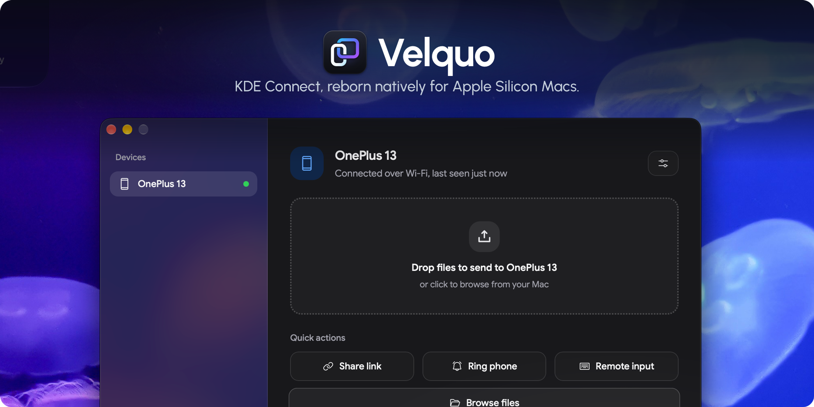

<p align="center">
    
</p>
<p align="center"><strong>KDE Connect, reborn natively for Apple Silicon Macs.</strong></p>
<p align="center">
    <a href="https://github.com/vsnthdev/Velquo/releases">
        
    </a>
    <a href="https://github.com/vsnthdev/Velquo/issues">
        
    </a>
    <a href="https://github.com/vsnthdev/Velquo/commits/main">
        
    </a>
</p>
<br>

**Velquo** is a native macOS rewrite of [KDE Connect](https://kdeconnect.kde.org/) for Apple Silicon (M-series) Macs — replacing legacy, unmaintained Intel-based clients to bring seamless device continuity to macOS from Android, with instant wireless file sharing and live media controls powered by Rust and Tauri.

Thanks for taking the time to contribute! This document covers the conventions this project enforces on every commit and pull request. Please read it before opening a PR.

---

## 🛠️ Getting Started

Velquo is built with **Rust** (Tauri backend) and **React + TypeScript** (frontend), managed with **Bun**.

```bash
bun install          # install frontend dependencies
bun run dev          # start the Vite dev server
bun run tauri dev    # run the full app with the Rust backend
```

Before opening a pull request, make sure these pass locally:

```bash
bun run build        # tsc + i18n catalog check + vite build
bun run lint         # eslint + cargo fmt + cargo clippy
cargo test --manifest-path src-tauri/Cargo.toml
```

---

## 💬 Commit Messages

**Commit messages must strictly follow the style guide at [vas.cx/commits](https://vas.cx/commits).**

The format is:

```text
<emoji> [issue hash] [scope:] <message in present tense in lowercase>

🚨 BREAKING CHANGE:
```

Rules to remember:

- Every commit starts with **one emoji** from the table below.
- The message is written in **present tense** — `add`, `fix`, `update`; never `added`, `fixed`, `updated`.
- The message is written in **lowercase**, including its first word — never `Add ...` or `Fix ...`.
- An **issue hash** (`#22`) is optional and goes right after the emoji.
- A **scope** is optional and goes before the message, followed by a colon — `cli:`, `database:`.
- Put a **`🚨 BREAKING CHANGE:`** footer when the commit breaks existing behaviour.

### Examples

```bash
🔨 change build script version
🐛 #22 fix browser window does not open
🐛 fix build fail
🐛 database: fix does not connect
🐛 #44 cli: fix wrong variables while in help cmd
🗺️ add Japanese and Korean translations
```

### Emojis & Their Meanings

| Emoji | Meaning | Description |
| --- | --- | --- |
| 🔨 | Chore | Updating build files, configs etc, **no production code change.** |
| 🐛 | Bug fix | A bug fix that affects the users, **not a fix in build files or configs.** |
| ✨ | New feature | Totally new functionality that affects the users. |
| 🎊 | Improvement | Code change that doesn't introduce a new feature, but rather improves an existing one. |
| 📚 | Docs | Changes to the documentation, **does not include any code changes.** |
| ♻️ | Refactor | Refactoring of project code **not configs or build scripts that doesn't change any behaviour.** |
| 💀 | Code deletion | Any deletion of code from the actual codebase, not scripts or config files. |
| 🧪 | Tests | Changes to test cases, **no project code change.** |
| 🎨 | Code formatting | Only code formatting, change in fixing indentation, quotes, etc. |
| 👷 | CI/CD changes | CI config changes, CI build script changes. |
| 👆 | Dependency updates | Updates to dependency libraries + required code changes. |
| 🚀 | New release | A new version of your project. |
| 🔒 | Security | A code change involving security of your project, improvement or vulnerability. |
| 🗺️ | Internationalization | A code change making the project internationally accessible, like translations to other languages. |
| 📁 | Database change | No code change, mostly used for database schema changes. |

---

## 🚢 Pull Request Titles

PR titles differ from commit messages in **tense** and **capitalization**:

| Context | Tense | Capitalization |
| --- | --- | --- |
| **PR title** | Past tense (`Added`, `Fixed`, `Improved`) | Title case, starts with a capital letter |
| **Commit message** | Present tense (`add`, `fix`, `improve`) | Lowercase, starts with a lowercase letter |

**Do not** put the emoji or the issue hash in the PR title — that is a commit-message convention only.

### Examples

✅ Good:

```text
Added Simplified and Traditional Chinese localization
Fixed file browser window not opening
Improved notification delivery on macOS
```

❌ Bad (present tense — this is how **commits** are written, not PRs):

```text
Add Simplified and Traditional Chinese localization
Fix file browser window not opening
```

❌ Also bad (commit-style emoji prefix in a PR title):

```text
🗺️ add Japanese and Korean translations
```

---

## ✅ Pull Request Checklist

- [ ] Commit messages follow [vas.cx/commits](https://vas.cx/commits) — emoji, present tense, lowercase.
- [ ] PR title is in past tense and title case.
- [ ] `bun run build` passes (TypeScript + translation catalogs).
- [ ] `bun run lint` passes (ESLint + `cargo fmt` + `cargo clippy`).
- [ ] Rust tests pass.
- [ ] New UI strings are added to every catalog in `src/i18n/locales/` and `bun run i18n:check` passes.
- [ ] Native (Rust-side) strings live in the same catalogs under the `native` namespace.

---

## 📰 License
> The **Velquo** project is released under the [zlib/libpng license](https://github.com/vsnthdev/Velquo/blob/main/LICENSE.md).
