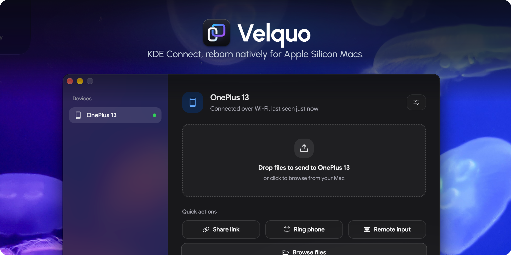

<p align="center">
    
</p>
<p align="center"><strong>KDE Connect, reborn natively for Apple Silicon Macs.</strong></p>
<p align="center">
    <a href="https://github.com/vsnthdev/Velquo/releases">
        
    </a>
    <a href="https://github.com/vsnthdev/Velquo/issues">
        
    </a>
    <a href="https://github.com/vsnthdev/Velquo/commits/main">
        
    </a>
</p>
<br>

**Velquo** is a native macOS rewrite of [KDE Connect](https://kdeconnect.kde.org/) for Apple Silicon (M-series) Macs — replacing legacy, unmaintained Intel-based clients to bring seamless device continuity to macOS from Android, with instant wireless file sharing and live media controls powered by Rust and Tauri.

> Tweet <a target="_blank" rel="noopener" href="https://vas.cx/twitter">@vsnthdev</a>, I would love to know your opinion & experience on this project 😍

## ✨ Features

1. **File Transfer** — Drag and drop files to send to your phone, or receive files straight into your Mac's `Downloads` folder
2. **Clipboard Sync** — Automatically syncs copied text between your Mac and phone, with per-device toggle control
3. **Notifications & OTP Auto-Copy** — Mirrors phone notifications to your Mac and automatically copies 2FA/OTP verification codes to your clipboard
4. **Media Control** — Control what's playing on your phone from your Mac, or control your Mac's media playback from your phone
5. **Link Sharing** — Send links between your Mac and phone to open them instantly in the default browser
6. **Auto-Pause on Calls** — Automatically pauses Mac media playback when your phone rings or is on a call, and resumes when the call ends
7. **Native Apple Silicon** — Lightweight, fast macOS app built natively for M-series Macs with menu bar and Dock support

## 🛠️ Build from Source

To package **Velquo** as a standalone macOS `.app` bundle and `.dmg` installer on an Apple Silicon Mac:

```bash
bun install
bun run bundle
```

The built artifacts are output to:
- **App Bundle:** `src-tauri/target/release/bundle/macos/Velquo.app`
- **DMG Installer:** `src-tauri/target/release/bundle/dmg/Velquo_0.1.0_aarch64.dmg`

